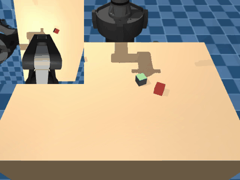

# homestri

MuJoCo pick-and-place environments with a UR5e arm and a Robotiq 2F-85 gripper, built
for VLA (vision-language-action) experiments. Gymnasium API, camera images + proprio +
language instruction, and a simple joint / end-effector command API.



## Install

```bash
uv sync
```

Requires Python ≥ 3.10. Dependencies: `mujoco`, `gymnasium`, `numpy`.

## Quick start

```python
import gymnasium as gym
import homestri  # registers the environments

env = gym.make("homestri/PickCube-v0", control_mode="eef_delta")
obs, info = env.reset(seed=0)
print(info["instruction"])            # e.g. "pick up the red cube"
obs["images"]["front"], obs["images"]["wrist"]   # (224, 224, 3) uint8
obs["state"]                          # qpos, gripper, eef_pos, eef_quat

obs, reward, terminated, truncated, info = env.step(env.action_space.sample())
```

Render a scripted demo to video, or watch it in the interactive viewer:

```bash
uv run python scripts/render_demo.py --env homestri/StackCubes-v0 --out stack.mp4
uv run mjpython scripts/view.py --env homestri/PlaceInBin-v0   # macOS: mjpython, Linux: python
```

## Tasks

| env id | instruction | success |
|---|---|---|
| `homestri/PickCube-v0` | "pick up the {color} cube" | cube lifted 10 cm and held by both fingers |
| `homestri/PlaceInBin-v0` | "put the {color} cube in the bin" | cube resting inside the bin, released |
| `homestri/StackCubes-v0` | "stack the {a} cube on the {b} cube" | cube a resting on cube b, released |

Cube positions, yaws, colors and the bin position are randomized from the reset seed.
Reward is `1.0` on success (which also terminates the episode); episodes truncate after
`max_episode_steps` (default 200). Pass `task_kwargs={"num_distractors": n}` to change the
number of extra cubes.

## Environment options

```python
gym.make(
    "homestri/PickCube-v0",
    control_mode="eef_delta",       # joint_pos | joint_delta | eef_pose | eef_delta
    obs_mode="rgb",                 # rgb | state
    camera_names=("front", "wrist"),
    image_size=(224, 224),
    control_hz=10,
    render_mode=None,               # rgb_array | human
    max_episode_steps=200,
)
```

| control_mode | action | |
|---|---|---|
| `joint_pos` | (7,) | 6 absolute joint positions [rad] + gripper |
| `joint_delta` | (7,) | 6 joint deltas + gripper |
| `eef_pose` | (8,) | position (3) + quaternion wxyz (4) + gripper |
| `eef_delta` | (7,) | Δposition (3) + Δrotation vector (3) + gripper |

Poses are in the robot base frame: origin at the arm mount, axes aligned with the world,
x pointing toward the table. The gripper command is in `[0, 1]` (0 = open). EEF commands
are converted to joint targets with damped-least-squares IK; `info["ik_error"]` reports
the residual position error. Delta actions accumulate on the previous commanded target.

## Robot API

The `Robot` class works without the gym wrapper:

```python
import mujoco
from homestri import Robot, build_model

model = build_model()
data = mujoco.MjData(model)
robot = Robot(model, data)
robot.reset()
mujoco.mj_forward(model, data)

robot.qpos, robot.gripper, robot.eef_pose
robot.move_eef([0.5, 0.1, 0.05], duration=2.0)   # blocking, straight-line motion
robot.set_gripper(1.0); robot.step(500)
robot.move_joints(robot.qpos + 0.1, duration=1.0)

robot.set_joint_target(q)          # non-blocking: set targets, then step the sim yourself
robot.set_eef_target(pos, quat)    # returns IKResult(qpos, pos_error, rot_error)
```

## Adding a task

Subclass `homestri.tasks.Task`, implement `objects_xml`, `reset`, `success` and
`scripted_targets`, then pass an instance: `ManipEnv(task=MyTask())`, or add it to
`homestri.tasks.TASKS` and `homestri.envs.registration.ENV_IDS`.

## Development

```bash
uv run pytest
uv run pre-commit install   # ruff format + ruff check
```

## Credits

Robot meshes come from the original
[ian-chuang/homestri-ur5e-rl](https://github.com/ian-chuang/homestri-ur5e-rl), which drew
on [MuJoCo Menagerie](https://github.com/google-deepmind/mujoco_menagerie),
[robosuite](https://github.com/ARISE-Initiative/robosuite),
[irl_control](https://github.com/ir-lab/irl_control) and
[abr_control](https://github.com/abr/abr_control).
