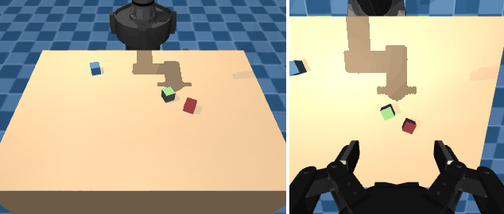
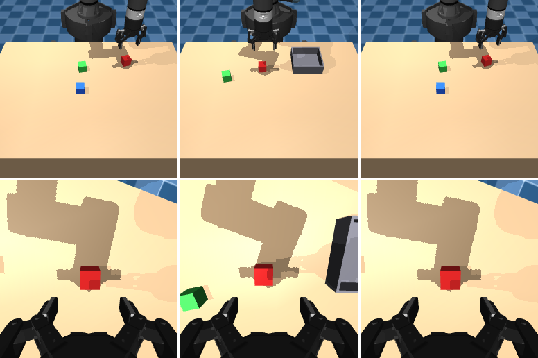

# homestri

**Lightweight MuJoCo pick-and-place environments for VLA research**, with a UR5e arm and a
Robotiq 2F-85 gripper.



*Scripted policy solving PickCube, PlaceInBin and StackCubes. Left: `front` camera. Right: `wrist` camera.*

- 🧩 **Language-conditioned tasks**: pick, place in a bin and stack, with randomized
  objects and colors.
- 📷 **VLA-ready observations**: front and wrist RGB cameras, proprioception and a
  natural-language instruction.
- 🕹️ **Simple control**: command joints or end-effector poses, as absolute or delta
  actions. IK is handled for you.
- ⚡ **Minimal setup**: one `uv sync`, three dependencies (`mujoco`, `gymnasium`, `numpy`).
  Runs headless on macOS and Linux.

## Contents

- [Installation](#installation)
- [Quick start](#quick-start)
- [Tasks](#tasks)
- [Observations](#observations)
- [Actions](#actions)
- [Robot API](#robot-api)
- [Scripts](#scripts)
- [Project layout](#project-layout)
- [Adding a task](#adding-a-task)
- [Development](#development)
- [Credits](#credits)

## Installation

```bash
git clone git@github.com:k1000dai/homestri-ur5e-rl.git
cd homestri-ur5e-rl
uv sync
```

Requires Python ≥ 3.10. To use it from another project, run
`uv add git+https://github.com/k1000dai/homestri-ur5e-rl`.

## Quick start

```python
import gymnasium as gym
import homestri  # registers the environments

env = gym.make("homestri/PickCube-v0", control_mode="eef_delta")
obs, info = env.reset(seed=0)

print(info["instruction"])         # "pick up the blue cube"
obs["images"]["front"]             # (224, 224, 3) uint8
obs["images"]["wrist"]             # (224, 224, 3) uint8
obs["state"]["eef_pos"]            # (3,) float32

obs, reward, terminated, truncated, info = env.step(env.action_space.sample())
```

A typical VLA evaluation loop:

```python
obs, info = env.reset(seed=seed)
while True:
    action = policy(obs["images"], obs["state"], info["instruction"])  # your model
    obs, reward, terminated, truncated, info = env.step(action)
    if terminated or truncated:
        break
print("success:", info["success"])
```

## Tasks

| Env ID | Example instruction | Success condition |
|---|---|---|
| `homestri/PickCube-v0` | "pick up the red cube" | cube lifted 10 cm and held by both fingers |
| `homestri/PlaceInBin-v0` | "put the blue cube in the bin" | cube at rest inside the bin and released |
| `homestri/StackCubes-v0` | "stack the red cube on the green cube" | top cube at rest on the bottom cube and released |

- The reset seed randomizes cube positions, yaws and colors, and the bin position.
- `task_kwargs={"num_distractors": n}` sets the number of extra cubes.
- Reward is `1.0` on success, otherwise `0.0`. Success also terminates the episode.
- Episodes truncate after `max_episode_steps` (default 200, i.e. 20 s at 10 Hz).

## Observations



*Top: `front` camera. Bottom: `wrist` camera, with both fingers visible so the policy can
see the gripper open and close.*

```text
obs = {
    "images": {                       # omitted when obs_mode="state"
        "front": (H, W, 3) uint8,
        "wrist": (H, W, 3) uint8,
    },
    "state": {
        "qpos":     (6,) float32,     # arm joint positions [rad]
        "gripper":  (1,) float32,     # 0 = open, 1 = closed
        "eef_pos":  (3,) float32,     # [m], robot base frame
        "eef_quat": (4,) float32,     # wxyz, robot base frame
    },
}
info = {"instruction": str, "success": bool, "ik_error": float}
```

All environment options:

```python
gym.make(
    "homestri/PickCube-v0",
    control_mode="eef_delta",         # joint_pos | joint_delta | eef_pose | eef_delta
    obs_mode="rgb",                   # rgb | state (no rendering, much faster)
    camera_names=("front", "wrist"),
    image_size=(224, 224),            # (H, W)
    control_hz=10,
    render_mode=None,                 # rgb_array | human
    render_size=(480, 640),           # for render_mode="rgb_array"
    max_episode_steps=200,
    max_delta_pos=0.05,               # eef_delta limit per step [m]
    max_delta_rot=0.25,               # eef_delta / joint_delta limit per step [rad]
    task_kwargs={"num_distractors": 2},
)
```

## Actions

| `control_mode` | Shape | Layout |
|---|---|---|
| `joint_pos` | (7,) | 6 absolute joint positions [rad], gripper |
| `joint_delta` | (7,) | 6 joint deltas [rad], gripper |
| `eef_pose` | (8,) | position (3) [m], quaternion wxyz (4), gripper |
| `eef_delta` *(default)* | (7,) | Δposition (3) [m], Δrotation vector (3) [rad], gripper |

- **Frame.** Poses use the *robot base frame*. Its origin is at the arm mount and its axes
  are aligned with the world: x points toward the table and z points up. The table
  surface is at z ≈ −0.04 m.
- **Gripper.** The gripper command is a continuous value in `[0, 1]`, where 0 is open.
- **Clipping.** Actions outside `env.action_space` are clipped.
- **IK.** EEF actions are converted to joint targets with damped-least-squares IK.
  Unreachable targets never raise an error; `info["ik_error"]` reports the residual
  error in meters.
- **Deltas.** Delta actions accumulate on the previous *commanded* target. Tracking lag
  therefore does not shrink a sequence of small steps.

## Robot API

Use `Robot` directly, without the Gym wrapper, for scripting, debugging or data
generation:

```python
import mujoco
from homestri import Robot, build_model

model = build_model()
data = mujoco.MjData(model)
robot = Robot(model, data)
robot.reset()
mujoco.mj_forward(model, data)

# State
robot.qpos, robot.gripper, robot.eef_pose

# Blocking helpers: interpolate and step the simulation for you
robot.move_eef([0.5, 0.1, 0.05], duration=2.0)    # straight line; quat=None keeps orientation
robot.set_gripper(1.0); robot.step(500)
robot.move_joints(robot.qpos + 0.1, duration=1.0)

# Non-blocking: set targets, then step the simulation yourself
robot.set_joint_target(q)
result = robot.set_eef_target(pos, quat)          # IKResult(qpos, pos_error, rot_error)
robot.step(50)
```

## Scripts

`homestri.scripted.ScriptedPickPlace` is a waypoint policy that solves all three tasks.
Use it for smoke tests, demos or bootstrapping data.

```bash
# Run the scripted policy and save a video (front view with the wrist view inset)
uv run python scripts/render_demo.py --env homestri/StackCubes-v0 --episodes 3 --out stack.mp4

# Interactive viewer (macOS needs mjpython; on Linux use python)
uv run mjpython scripts/view.py --env homestri/PlaceInBin-v0
```

On a headless Linux machine, set `MUJOCO_GL=egl` (or `osmesa`) to render offscreen.

## Project layout

```text
src/homestri/
├── assets/
│   ├── meshes/            # UR5e, Robotiq 2F-85 and pedestal meshes
│   ├── robot/             # ur5e_2f85.xml: position actuators, wrist camera, eef site
│   └── scenes/            # table.xml: table, lights, front camera
├── sim/
│   ├── robot.py           # Robot: state, joint/EEF/gripper commands
│   ├── ik.py              # damped-least-squares IK
│   ├── scene.py           # build_model(): robot + scene + task objects
│   └── camera.py          # offscreen RGB rendering
├── tasks/                 # Task interface, PickCube, PlaceInBin, StackCubes
├── envs/                  # ManipEnv (gymnasium.Env) and registration
└── scripted.py            # scripted pick-and-place policy
scripts/                   # render_demo.py, view.py
tests/                     # pytest suite
```

## Adding a task

Subclass `homestri.tasks.Task`:

```python
from homestri.tasks import Task

class MyTask(Task):
    name = "my_task"

    def objects_xml(self) -> str: ...        # MJCF for the objects you need
    def reset(self, model, data, rng): ...   # randomize objects, set self.instruction
    def success(self, model, data) -> bool: ...
    def scripted_targets(self, model, data): ...  # (pick_pos, pick_yaw, place_pos) in world frame
```

Then use it directly with `ManipEnv(task=MyTask())`, or add it to `homestri.tasks.TASKS`
and `homestri.envs.registration.ENV_IDS` to get a Gym ID. The helpers in
`homestri/tasks/base.py` (`cube_xml`, `sample_positions`, `is_grasped`, …) cover most
tabletop setups.

## Development

```bash
uv run pytest                  # full test suite (~2 s)
uv run pre-commit install      # ruff format + ruff check on every commit
```

## Credits

This is a fork of [ian-chuang/homestri-ur5e-rl](https://github.com/ian-chuang/homestri-ur5e-rl),
rewritten for MuJoCo 3 and Gymnasium 1.x. The robot models derive from
[MuJoCo Menagerie](https://github.com/google-deepmind/mujoco_menagerie), and the original
project drew on [robosuite](https://github.com/ARISE-Initiative/robosuite),
[irl_control](https://github.com/ir-lab/irl_control) and
[abr_control](https://github.com/abr/abr_control).
